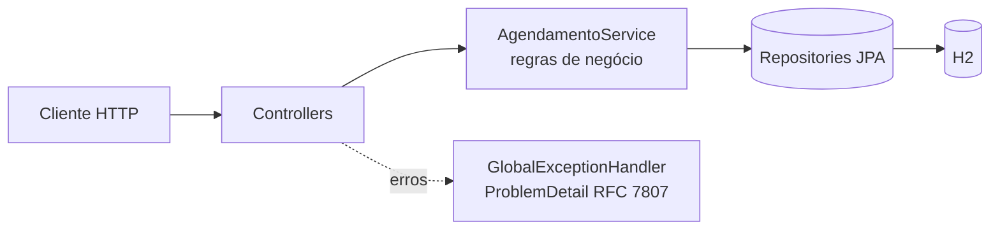

# 📅 Agenda Inteligente API

API REST para **agendamento de serviços** (salões, clínicas, estúdios) construída com **Java 17 + Spring Boot 3**.
Vai além de um CRUD: aplica regras de negócio reais de agenda — jornada de trabalho, intervalo de almoço, detecção de conflitos, antecedência mínima, política de cancelamento e cálculo de horários livres.


## ✨ Regras de negócio

| Regra | Descrição |
|------|-----------|
| 🕗 Jornada | O profissional só atende nos dias e horários cadastrados |
| 🍽️ Intervalo | Nenhum atendimento pode invadir o horário de almoço |
| ⚔️ Conflito | Dois agendamentos confirmados não podem se sobrepor para o mesmo profissional |
| ⏱️ Antecedência | Agendamentos exigem pelo menos **1h** de antecedência |
| ❌ Cancelamento | Só é possível cancelar até **2h** antes do início, com motivo obrigatório |
| 🔁 Reagendamento | Reaplica todas as validações, ignorando o próprio horário antigo |
| 🔎 Disponibilidade | Calcula os horários livres do dia em blocos de 15 minutos |

## 🏗️ Arquitetura



```
src/main/java/com/weslei/agenda
├── domain/        # Entidades e regras do domínio (Profissional, Servico, Agendamento)
├── repository/    # Spring Data JPA + consulta de conflito
├── service/       # AgendamentoService: onde ficam as regras
└── web/           # Controllers, DTOs (records) e tratamento de erros
```

## 🚀 Como rodar

Pré-requisitos: **Java 17+** e **Maven 3.9+**.

```bash
mvn spring-boot:run
```

A API sobe em `http://localhost:8080` com dados de exemplo (profissionais e serviços).
Console do banco: `http://localhost:8080/h2-console` (JDBC URL `jdbc:h2:mem:agenda`).

Rodar os testes:

```bash
mvn test
```

## 📡 Endpoints

| Método | Rota | Descrição |
|-------|------|-----------|
| GET | `/api/profissionais` | Lista profissionais |
| GET | `/api/servicos` | Lista serviços |
| GET | `/api/profissionais/{id}/disponibilidade?servicoId=1&data=2026-12-01` | Horários livres no dia |
| POST | `/api/agendamentos` | Cria um agendamento |
| GET | `/api/agendamentos?profissionalId=1&data=2026-12-01` | Agenda do dia |
| PATCH | `/api/agendamentos/{id}/cancelamento` | Cancela com motivo |
| PATCH | `/api/agendamentos/{id}/reagendamento` | Muda o horário |

### Exemplo

```bash
curl -X POST http://localhost:8080/api/agendamentos \
  -H "Content-Type: application/json" \
  -d '{"profissionalId":1,"servicoId":1,"cliente":"Maria","inicio":"2026-12-01T09:00:00"}'
```

Resposta de conflito (HTTP 422):

```json
{
  "title": "Regra de negócio violada",
  "status": 422,
  "detail": "Horário indisponível: conflita com outro agendamento"
}
```

## 🧪 Testes

Os testes de `AgendamentoServiceTest` usam um `Clock` fixo, o que deixa as regras de tempo (antecedência e prazo de cancelamento) determinísticas.

## 🗺️ Roadmap

- [ ] Autenticação com Spring Security + JWT
- [ ] Notificação por e-mail/WhatsApp antes do horário
- [ ] PostgreSQL + Flyway + Docker Compose
- [ ] Documentação OpenAPI/Swagger

---
Desenvolvido por [Weslei Sousa](https://github.com/joseweslei45-debug) · Licença MIT
